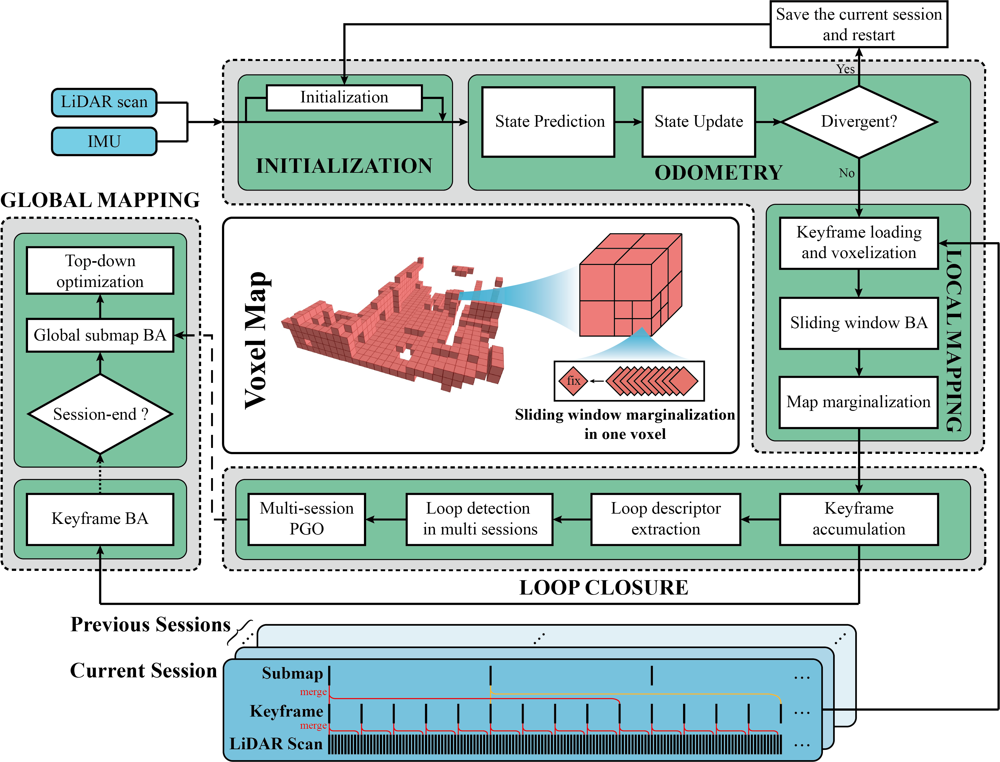

# Voxel-SLAM：完整、精确且通用的激光雷达-惯性 SLAM 系统

## 1. 项目简介

**Voxel-SLAM** 是一套完整、精确且通用的激光雷达-惯性 SLAM 系统，充分利用短期、中期、长期以及多地图数据关联。系统包含初始化、里程计、局部建图、回环检测和全局建图五个模块。

初始化模块能够在静止或运动的初始状态下提供精确的状态估计和局部地图；里程计模块估计当前状态并检测系统可能出现的发散；局部建图模块通过激光雷达-惯性束调整（BA）优化滑动窗口内的状态与局部地图；回环检测支持跨多个会话进行匹配；全局建图模块通过高效的分层全局束调整优化全局地图。系统总体结构如下：

<div align="center">
    <a href="https://youtu.be/Cg9W01aIUzE" target="_blank">
    
</div>

### 1.1 相关视频

**Voxel-SLAM** 的演示视频可在 [YouTube](https://youtu.be/Cg9W01aIUzE) 上观看。

### 1.2 相关工作

相关论文可在 [arXiv](https://arxiv.org/abs/2410.08935) 上查看。

### 1.3 竞赛成绩

Voxel-SLAM 曾作为子系统参加 [ICRA HILTI 2023 SLAM Challenge](https://hilti-challenge.com/leader-board-2023.html)，获得激光雷达单会话赛道第 **2** 名；参加 [ICCV 2023 SLAM Challenge](https://superodometry.com/iccv23_challenge_LiI)，获得激光雷达-惯性赛道第 **1** 名。

## 2. 环境依赖

- Ubuntu 20.04
- [ROS Noetic](http://wiki.ros.org/ROS/Installation)
- [PCL 1.10](https://pointclouds.org/)
- [Eigen 3.3.7](https://eigen.tuxfamily.org/index.php?title=Main_Page)
- [GTSAM 4.0.3](https://github.com/borglab/gtsam/releases?page=2)
- [livox_ros_driver](https://github.com/Livox-SDK/livox_ros_driver)

## 3. 编译

```bash
cd ~/catkin_ws/src
git clone https://github.com/hku-mars/Voxel-SLAM
cd ..
catkin_make
source ~/catkin_ws/devel/setup.bash
```

## 4. 运行 Voxel-SLAM

### 4.1 Livox Avia

在线重定位实验所使用的 rosbag 可从 [OneDrive](https://1drv.ms/f/c/8b1ef18ae4181c8d/ErEznhkJzTxJiLuJ8AQDGS0BvCy6KsuaWF2D6cnx061GEQ?e=dMRSlf) 或 [Google Drive](https://drive.google.com/file/d/1LG46i0vreQrMZRap5tJkjKK4IX0t0zfC/view?usp=drive_link) 下载。

```bash
roslaunch voxel_slam vxlm_avia.launch
# 使用 --pause 可以保证不同实验从相同的 rosbag 时刻开始。
# 按空格键开始播放。
rosbag play compus_elevator.bag --pause
```

设备位于电梯内时，系统会持续尝试重新初始化，直到设备离开电梯。蓝色点云表示初始化阶段建立的地图。

rosbag 播放结束后，地图可能会像演示视频中一样存在不一致。执行以下命令启动最终的全局建图（全局束调整），以优化全局地图：

```bash
rosparam set finish true
```

### 4.2 HILTI 2023（多会话）

多会话实验 rosbag 可从 [OneDrive](https://1drv.ms/f/c/8b1ef18ae4181c8d/Epp5AQ2Oq1VNhC6MIuCAtN4BJC9jx9VvuVx7VT_cdlvD0A?e=8mXYdc) 下载并进行快速测试。完整的 HILTI 2022 和 HILTI 2023 数据可从[官方网站](https://hilti-challenge.com/index.html)获取。

建议按照 `site1_handheld_5` 到 `site1_handheld_1` 的顺序播放 rosbag，否则 `site1_handheld_2` 和 `site1_handheld_3` 可能无法检测到回环。

启动前，请在 `hesai.yaml` 中配置以下参数。`#` 表示注释：

```yaml
# hesai.yaml
save_path: "${YOUR_FILE_PATH_TO_SAVE_THE_OFFLINE_MAP}"
previous_map: "# site1_handheld_5: 0.50,
               # site1_handheld_4: 0.45,
               # site1_handheld_3: 0.30,
               # site1_handheld_2: 0.50"
bagname: "site1_handheld_${1-5}" # 当前播放的 rosbag 名称
is_save_map: 1 # 启用地图保存
```

首先运行 `site1_handheld_5`：

```bash
roslaunch voxel_slam vxlm_hesai.launch
rosbag play site1_handheld_5.bag --pause
```

加载 `site1_handheld_5`，然后运行 `site1_handheld_4`：

```bash
roslaunch voxel_slam vxlm_hesai.launch
rosbag play site1_handheld_4.bag --pause
```

加载 `site1_handheld_5` 和 `site1_handheld_4`，然后运行 `site1_handheld_3`：

```bash
roslaunch voxel_slam vxlm_hesai.launch
rosbag play site1_handheld_3.bag --pause
```

运行 `site1_handheld_2` 前不要忘记加载已有离线地图，此时 `hesai.yaml` 应类似如下配置：

```yaml
# hesai.yaml
save_path: "${YOUR_FILE_PATH_TO_SAVE_THE_OFFLINE_MAP}"
previous_map: "site1_handheld_5: 0.50,
               site1_handheld_4: 0.45,
               site1_handheld_3: 0.30,
               # site1_handheld_2: 0.50"
bagname: "site1_handheld_2" # 当前播放的 rosbag 名称
is_save_map: 1 # 启用地图保存
```

加载 `site1_handheld_5`、`site1_handheld_4` 和 `site1_handheld_3`，然后运行 `site1_handheld_2`：

```bash
roslaunch voxel_slam vxlm_hesai.launch
rosbag play site1_handheld_2.bag --pause
```

加载前四个会话后运行 `site1_handheld_1`：

```bash
roslaunch voxel_slam vxlm_hesai.launch
rosbag play site1_handheld_1.bag --pause
```

地图可能仍会出现演示视频中的不一致。执行以下命令进行最终全局束调整：

```bash
rosparam set finish true
```

### 4.3 MARS 数据集

快速测试数据可从 [OneDrive](https://1drv.ms/f/c/8b1ef18ae4181c8d/EpjsGW6coYlMvBWo8TlgJXoBttAuoocLi24V6kw-r_3A8w?e=vVB6RY) 下载，完整 MARS 数据集可从[官方网站](https://mars.hku.hk/dataset.html)获取。

```bash
roslaunch voxel_slam vxlm_avia_fly.launch
rosbag play HKisland03.bag --pause
```

该数据起始阶段点云为空，系统会持续尝试初始化，直到无人机上升到一定高度。

```bash
roslaunch voxel_slam vxlm_avia_fly.launch
rosbag play AMvalley03.bag --pause
rosparam set finish true
```

该序列较难检测到回环，请运行 GBA 以保证全局地图的一致性。

### 4.4 Livox Mid-360

该 rosbag 开始时运动速度较快，可从 [OneDrive](https://1drv.ms/f/c/8b1ef18ae4181c8d/ErtuXCFhFrBErZxzS5vLASkBJEfgDB9R2CSCgKe8BwhneQ?e=zbr7NL) 下载。

```bash
roslaunch voxel_slam vxlm_mid360.launch
rosbag play jungle_challenge.bag --pause
```

### 4.5 构建可复用地图并进行定位

建图和定位使用同一个 `voxelslam` 可执行程序。

#### 4.5.1 导出定位地图

在建图配置中保持 `General/mode: mapping`，并在 `VoxelSLAM/config/mid360.yaml` 中设置 `General/map_export_path`。目标目录必须尚不存在，但其父目录必须已经存在。`MapBlock` 配置决定定位地图的固定空间划分：默认块尺寸为 20 m × 20 m × 10 m，块内融合分辨率为 0.1 m，根体素边长为 1 m，静态八叉树最大层数为 2。

正常运行建图，然后触发最终全局优化和地图导出：

```bash
roslaunch voxel_slam vxlm_mid360.launch
rosbag play mapping.bag --pause
rosparam set finish true
```

程序仅在最终优化完成后以事务方式写入 v2 地图包，避免留下不完整目录。主要内容如下：

- `manifest.yaml`：格式版本、坐标系、BTC 指纹、关键帧数量和不可修改的空间块参数；
- `keyframes.csv` 与 `keyframes/`：BTC 范围筛选、最近高度查询和兼容数据；
- `btc_frames.bin` 与 `btc_planes/`：BTC 重定位数据库；
- `spatial_blocks.idx`：非空空间块的哈希索引、包围盒、偏移、长度和校验信息；
- `spatial_blocks.bin`：融合后的不可变空间块、根体素、静态八叉树节点和平面数据。

如果最终关键帧过于稀疏，或 `MapBlock` 阈值导致无法生成任何有效平面空间块，导出会明确失败并清理临时目录，不会生成一个无法定位的空 v2 地图包。

定位不会遍历全部历史关键帧，也不会重建整张局部体素地图。它只枚举当前位置和预测位置附近的规则块坐标，通过索引进行平均常数时间查找，在后台加载缺失块，并以不可变快照供一次完整 IESKF 更新使用。

#### 4.5.2 将旧 v1 地图转换为 v2

定位程序只接受 v2 地图。已有 v1 地图可在 Ubuntu 编译完成后转换：

```bash
rosrun voxel_slam build_spatial_map \
  --input /absolute/path/to/v1_map \
  --output /absolute/path/to/v2_map \
  --size-x 20 --size-y 20 --size-z 10 \
  --fusion-leaf 0.1 --root-voxel 1.0 \
  --max-layer 2 --min-eigen 0.0025
```

输入目录和输出目录不能相同、不能互相嵌套，输出目录也不能预先存在。转换程序完成写入后会重新读取索引并校验全部空间块；校验失败时不会保留不完整的 v2 输出。

#### 4.5.3 启动地图定位

可以在 `VoxelSLAM/config/localization_mid360.yaml` 中设置 `Localization/map_path`，也可以通过 launch 参数传入地图路径：

```bash
roslaunch voxel_slam vxlm_localization_mid360.launch \
  map_path:=/absolute/path/to/map_package
rosbag play localization.bag --pause
```

`Localization/spatial_map` 只控制运行时策略：

- `preload_radius`：重定位后必须先加载完成的核心半径；
- `load_radius`：当前位置及预测位置周围的目标加载半径；
- `unload_radius`：卸载滞回半径，必须大于 `load_radius`；
- `prefetch_time_sec`：使用当前速度预测前方加载中心的时间；
- `map_gap_timeout_sec`：核心块持续未就绪时允许仅 IMU 传播的最长时间；
- `preload_timeout_sec`：首次局部地图准备超时；
- `max_background_loads`：并行磁盘加载线程数。

块尺寸、融合分辨率、根体素尺寸、八叉树层数和平面阈值必须以 `manifest.yaml` 为准，定位 YAML 不能覆盖这些格式参数。

当 `use_prior_pose_for_btc: true` 时，BTC 仅从 `btc_prior_pose.x/y` 周围 `btc_search_radius` 范围内的历史关键帧中选择候选。匹配失败后，搜索半径会逐步扩大到 `btc_max_search_radius`，随后可根据配置回退到全局搜索。候选筛选有意不使用 yaw 约束。

当 `use_prior_pose_for_btc: false` 时，先验位置以及半径、扩展和回退设置均不参与候选筛选，BTC 会直接进行全局搜索。

#### 4.5.4 使用 RViz 设置初始位姿

当 `rviz_initialpose_enabled` 为 `true` 时，RViz 的 **2D Pose Estimate** 始终是一条独立的初始化路径：

- x、y 和 yaw 取自 RViz 输入，表示车辆当前在 `map` 坐标系中的位姿。
- roll 和 pitch 取自实时 IMU 姿态。
- z 取自 XY 平面内距离输入位置最近的历史关键帧高度。
- 该路径跳过 BTC，但必须先加载输入位姿附近的核心空间块，并在连续 `direct_pose_validation_scans` 帧通过静态局部地图匹配验证后，定位才会生效。
- 新的 RViz 位姿请求会替换尚未完成的旧请求。

#### 4.5.5 定位状态与自动恢复

程序发布以下锁存状态话题：

- `/localization/state`（`std_msgs/String`）：可能为 `WAITING_FOR_MAP`、`LOCAL_ODOMETRY`、`RELOCALIZING`、`ALIGNING`、`PREPARING_LOCAL_MAP`、`IN_MAP_TRACKING` 或 `LOST`。
- `/localization/valid`（`std_msgs/Bool`）：只有 BTC 对齐成功或 RViz 初始位姿通过局部地图验证后才为 `true`。

`PREPARING_LOCAL_MAP` 表示全局位姿已经应用，但核心空间块尚未全部就绪，或者 RViz 位姿仍在连续扫描验证中。核心块加载期间只进行 IMU 传播，不把当前扫描插入静态地图。连续跟踪时若车辆进入尚未加载的区域，系统先回滚本帧激光更新并等待后台加载；缺口持续超过阈值、核心块损坏、坏帧达到阈值或求解出现非有限数值时进入 `LOST`。系统随后清理当前 Session 并返回局部里程计和 BTC 恢复流程，磁盘地图和历史 BTC 数据不变。

#### 4.5.6 定位结果与实时性评估

使用以下命令，将 TUM 格式的估计轨迹与地图坐标系下的 TUM 真值轨迹进行比较，并检查定位过程中地图包是否发生变化：

```bash
python3 VoxelSLAM/scripts/evaluate_localization.py \
  --estimate estimate.tum \
  --reference reference.tum \
  --map-dir /absolute/path/to/map_package \
  --runtime-log spatial_runtime.log
```

评估工具输出以下结果：

- 不进行事后对齐的地图坐标系 ATE RMSE。
- 平移 RPE 和旋转 RPE。
- 地图包中每个文件的 SHA-256。
- 与路径相关且结果确定的整目录 SHA-256。
- 活动块数和待加载块数峰值、核心块就绪比例。
- 单块加载、静态地图匹配和整帧处理耗时的平均值、P95 与最大值。
- 已加载静态空间块数据的估算内存峰值。

定位时程序会输出形如 `SPATIAL_MAP active=...` 的诊断行，可用 `roslaunch ... 2>&1 | tee spatial_runtime.log` 保存。论文实验至少应记录加载耗时、匹配耗时、整帧耗时的平均值、P95、最大值，以及内存峰值。建议在定位前后分别运行一次评估工具，两次输出的所有地图哈希值必须完全一致。

#### 4.5.7 Ubuntu 验证与 Windows 可执行检查

完整构建和 C++ 测试必须在安装 ROS Noetic、PCL、GTSAM 和 Livox 驱动的 Ubuntu 20.04 环境中执行：

```bash
cd ~/catkin_ws
catkin_make
catkin_make run_tests
catkin_test_results
python3 -m unittest VoxelSLAM/test/evaluate_localization_test.py
```

随后分别使用建图 rosbag 导出 v2 地图、使用定位 rosbag 验证 BTC 和 RViz 两条初始化路径，并检查 `/localization/state`、`/localization/valid`、轨迹误差、实时性日志和地图哈希。

Windows 当前只能执行不依赖 ROS/PCL/GTSAM 的检查，不能代替 Ubuntu 编译和 rosbag 集成测试：

```powershell
python -m unittest VoxelSLAM/test/evaluate_localization_test.py
git diff --check
```

### 4.6 其他类型激光雷达

其他类型激光雷达的支持将在后续发布。

## 5. VoxelSLAMPointCloud2

**VoxelSLAMPointCloud2** 是一个定制的 RViz 插件，用法与原生 `PointCloud2` 基本一致。无论插件的 **Decay Time** 设置为何，当插件收到空点云时，都可以自动清除当前显示的点云地图。

使用步骤：

1. 将 `VoxelSLAMPointCloud2` 放入 catkin 工作空间的同一个 `src` 目录，然后执行 `catkin_make`。
2. 使用 `roslaunch` 启动程序和 RViz。
3. 在 RViz 中单击 **Add**，添加 `VoxelSLAMPointCloud2` 显示项。
