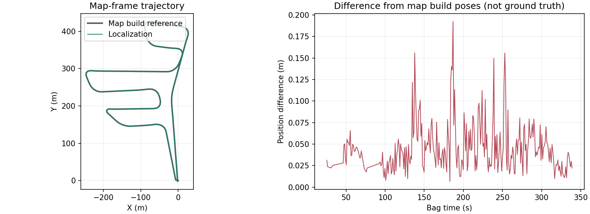

# HKisland03 ROS2 Localization Replay

## Test Conditions

- ROS2 Humble, 1x replay of `converted_HKisland03_livox2` (approximately 340 s).
- Automatic BTC initialization against the corresponding v2 localization map.
- Both runs used isolated ROS domain 78.
- Avia LiDAR/IMU extrinsics, high-altitude BTC settings, `down_size=0.5`, and
  tracking quality thresholds were unchanged between the two runs.
- The saved map was unchanged: 282 keyframes, 0.1 m fusion grid, 1 m roots.
- The only algorithm-configuration change was the spatial core/load/unload
  radii: 15/30/40 m versus 100/120/150 m.

## Baseline: 15/30/40 m

First valid localization occurred at 20.48 s after the first IMU header
timestamp. Tracking entered LOST at approximately 54.5 s, after 34.02 s of
valid tracking. Subsequent BTC matches succeeded, but local map preparation
repeatedly timed out because required core blocks were outside the radius.

Repeated recovery eventually aborted with `double free or corruption` at
approximately 102 s; the baseline did not complete. Its recovery-path heap
error remains unresolved. Map hashes remained unchanged.

The nearest saved block AABB was 61.62 m away at the median map keyframe
position, 82.61 m at P95, and 86.54 m at maximum. Only 10 of 282 reference
positions had a block within 15 m. The airborne sensor is far from the
surfaces stored in the map, so short ground-platform loading radii were
unsuitable for this dataset.

## Expanded Range: 100/120/150 m

| Metric | Result |
| --- | --- |
| Complete playback | Approximately 340 s, no runtime failure |
| First valid localization | 24.60 s |
| Continuous validity after first localization | 316.00 s |
| LOST transitions after first localization | 0 |
| Subsequent relocalizations | 0 |
| Core blocks ready | All 3,141 tracking diagnostic samples |
| Active blocks, maximum | 250 |
| Reported spatial-block memory, peak | 73.55 MB (not total process memory) |
| Frame time, mean / P95 / maximum | 58.04 / 92.15 / 104.05 ms |
| Map file SHA-256 before/after | Identical |

## Trajectory Consistency



Reference poses are the final optimized poses in the map package's
`keyframes.csv`, not independent ground truth. Each reference pose was paired
with the nearest valid IMU-rate localization output within 20 ms. There were
276 pose pairs; the actual maximum timestamp difference was 2.54 ms.
No post-hoc rigid alignment was applied.

- Position difference RMSE: 0.05369 m.
- Position difference P95 / maximum: 0.10129 / 0.19243 m.
- Relative translation RMSE: 0.04121 m.
- Relative rotation RMSE: 0.15517 degrees.

This demonstrates same-bag consistency, not independent absolute accuracy,
cross-session robustness, or successful LOST recovery. The tuned run never
entered LOST and therefore did not exercise the failing recovery path. The
known invalid-rclcpp-context exception on SIGINT is separate and unchanged.

Machine-readable results are in [expanded_metrics.json](hkisland03_expanded_metrics.json).
The figure and metrics were copied from the previously completed replay;
this documentation update did not rerun that bag.

## Reproduction

After building and sourcing the ROS2 workspace, start localization:

```bash
ros2 launch voxel_slam vxlm_localization_avia_fly.launch.py \
  map_path:=/absolute/path/to/HKisland03_localization rviz:=true
```

In a second sourced terminal, start the corresponding bag and press Space
after the node is ready:

```bash
ros2 bag play /absolute/path/to/converted_HKisland03_livox2 \
  --clock --start-paused
```

The launch loads `VoxelSLAM/config/ros2_localization_avia_fly.yaml`, which
contains the tested 100/120/150 m radii. The map and bag are external data,
not included in this repository. The mapping YAML currently contains local
Kunpeng output paths; edit those paths before using it on another machine.
Custom Livox input currently uses `livox_ros_driver2/msg/CustomMsg`; the
separate Avia driver's `livox_interfaces/msg/CustomMsg` is not yet supported.
